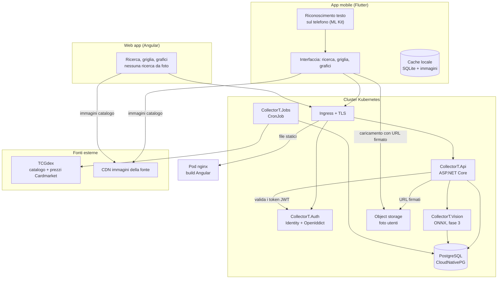
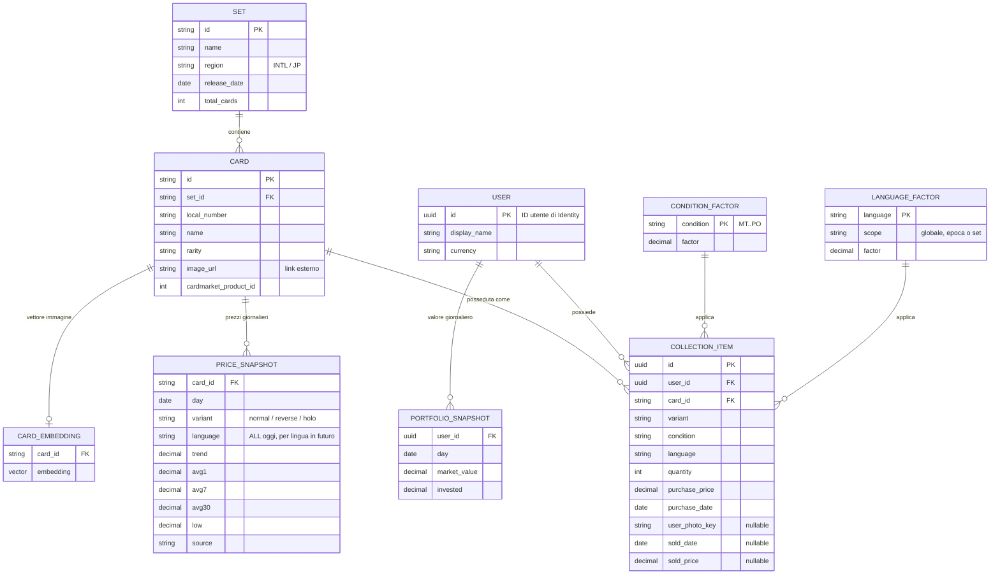
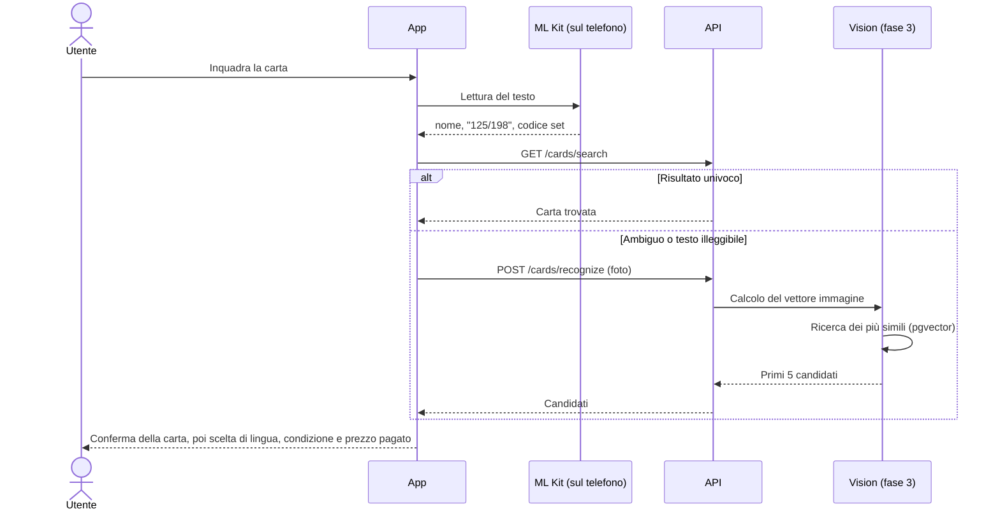

# CollectorT: architettura (bozza v2)

App mobile **gratuita** per tracciare la propria collezione di carte Pokémon e il suo valore, con prezzi di riferimento Cardmarket. App **non ufficiale**, destinata alla pubblicazione sugli store.

---

## 1. Decisioni prese

| Tema | Decisione | Note |
|---|---|---|
| Immagini di catalogo | **Opzione A**: nel DB solo il link, immagine servita dal CDN della fonte e tenuta nella cache del telefono | È la scelta meno rischiosa, ma il rischio non è zero (§3) |
| Prezzo di riferimento | **`trend` di Cardmarket** | È una media "smussata" delle vendite recenti, non il prezzo dell'ultimo istante (§3) |
| Condizione | **Coefficienti di condizione** | Configurabili lato server |
| Lingua | **Valore distinto per lingua** | Non c'è una fonte gratuita con prezzi per lingua: si parte da coefficienti (§3) |
| Modello di business | **Gratuita** | Si usano solo fonti dati gratuite; i costi di hosting sono a carico tuo |
| Backend | **Personalizzato: .NET + PostgreSQL + Kubernetes** | Consiglio **.NET 10** invece di .NET 8 (§4) |
| App mobile | **Flutter** | |
| Autenticazione | **ASP.NET Core Identity + OpenIddict** | Servizio `CollectorT.Auth` (§7.5) |
| Coefficienti | **Fissi lato server** | L'utente non li modifica |
| Carte giapponesi | **Presenti dalla prima versione** | Prezzi Cardmarket spesso scarsi o assenti (§3) |
| Hosting | **Oracle Cloud Always Free + k3s** | Confermato (§4.1) |
| Versione web | **Angular**, senza ricerca da foto | Stesse API e stesso login dell'app mobile (§5.1) |

---

## 2. Requisiti funzionali

| # | Funzionalità |
|---|---|
| F1 | Ricerca per nome o numero della carta |
| F2 | Ricerca tramite foto della carta |
| F3 | Collezione in griglia: foto dell'utente se presente, altrimenti l'immagine di catalogo |
| F4 | Dashboard: valore totale rispetto all'investito, guadagno/perdita in € e % (stile Scalable) |
| F5 | Dettaglio carta: grafico del valore e saldo rispetto al prezzo di acquisto |
| F6 | Prezzi da Cardmarket (trend), con coefficienti di condizione e lingua |
| F7 | Login e gestione credenziali |
| F8 | App non ufficiale, solo dati pubblici |

---

## 3. Vincoli e rischi

> [!WARNING]
> **Immagini: l'opzione A riduce il rischio, non lo azzera.** Anche mostrare un'immagine ospitata altrove resta un uso di materiale protetto. In pratica molte app di collezionismo sugli store fanno così e vengono tollerate, ma servono comunque:
> - la dicitura "app non affiliata, © The Pokémon Company";
> - una procedura di rimozione su richiesta;
> - nessun logo ufficiale e nessun "Pokémon" nel nome o nell'icona dell'app.
>
> Prima della pubblicazione conviene un parere legale.

> [!WARNING]
> **I prezzi per lingua non sono disponibili gratuitamente.** Il listino prezzi Cardmarket, che arriva anche tramite TCGdex, è calcolato **per prodotto e non per lingua**: una stessa carta in inglese, italiano o tedesco ha un solo `trend`. Le carte **giapponesi** invece su Cardmarket sono **prodotti separati**, con set e prezzi propri.
>
> Il prezzo per lingua sul sito Cardmarket si vede solo filtrando le offerte, quindi richiederebbe l'API (chiusa) o lo scraping (vietato).

**Strategia proposta per la lingua:**
1. **Giapponese:** catalogo separato, con prezzi propri dove la fonte li fornisce.
2. **Lingue occidentali (EN/IT/DE/FR/ES/PT):** prezzo base `trend`, moltiplicato per un **coefficiente di lingua** configurabile lato server, ad esempio per set o per epoca. È un'approssimazione e l'app la dichiara come tale.
3. **Già pronto per dopo:** `PRICE_SNAPSHOT` ha una colonna `language`, oggi valorizzata `ALL`. Se un giorno ottieni l'accesso API da Cardmarket, si salvano prezzi reali per lingua senza cambiare il modello.

> [!NOTE]
> **Cos'è il `trend` di Cardmarket.** È un valore calcolato da Cardmarket a partire dalle vendite recenti, quindi è stabile e poco sensibile ai picchi. Il valore più vicino all'"istante" sarebbe `avg1`, cioè il prezzo medio di vendita del giorno precedente, che però è molto rumoroso sulle carte poco scambiate. Per un grafico di portafoglio il `trend` è la scelta giusta.

**Formula del valore di una carta:**

$$
P = \text{trend}(\text{carta}, \text{variante}) \times k_{\text{condizione}} \times k_{\text{lingua}}
$$

Coefficienti di condizione iniziali, sulla scala Cardmarket, da tarare e rendere configurabili:

| MT | NM | EX | GD | LP | PL | PO |
|---|---|---|---|---|---|---|
| 1.00 | 1.00 | 0.85 | 0.70 | 0.60 | 0.45 | 0.30 |

I coefficienti sono **fissi lato server** (tabelle `CONDITION_FACTOR` e `LANGUAGE_FACTOR`). L'app li mostra all'utente per trasparenza.

> [!WARNING]
> **Carte giapponesi.** TCGdex ha il catalogo giapponese completo (set e numerazione propri), ma Cardmarket è un mercato europeo: per molte carte giapponesi i prezzi sono **scarsi o assenti** (`null`).
>
> Gestione proposta:
> - Il catalogo giapponese è separato, con `SET.region = JP`.
> - Le carte giapponesi sono collegate alla carta internazionale equivalente, dove esiste, tramite numero del Pokédex e illustrazione. Così una ricerca "Charizard" trova anche リザードン.
> - Se manca il prezzo, la carta è marcata "valore non disponibile" ed **esclusa dai totali**: sia dal valore sia dall'investito, così il saldo non risulta falsato. La dashboard indica quante carte sono escluse ("3 carte senza prezzo"). Non si usano altre fonti come stima, per restare coerenti con "solo Cardmarket".
> - Il riconoscimento del testo usa il modello giapponese di ML Kit. Il numero della carta (es. "025/071") resta il dato più affidabile.

> [!IMPORTANT]
> **Lo storico dei prezzi va costruito da noi**, salvando ogni giorno un'istantanea dei prezzi. I grafici partono dal primo giorno di raccolta, quindi il job di importazione va avviato **per primo**.

> [!IMPORTANT]
> **App gratuita: costi e fonti.**
> - Niente Scrydex o altre fonti a pagamento: solo **TCGdex**, di cui vanno verificati i termini d'uso commerciale.
> - Hosting a carico tuo: un cluster Kubernetes gestito con PostgreSQL gestito costa diverse decine di €/mese. In alternativa, k3s su una VPS economica (es. Hetzner) costa pochi €/mese.
> - Altri costi: account Apple (99 \$/anno) e Google (25 \$ una tantum).
> - In futuro si può valutare donazioni o pubblicità non invasiva.

---

## 4. Stack tecnologico

| Strato | Scelta | Motivazione |
|---|---|---|
| Mobile | **Flutter** | Fotocamera e ML Kit maturi, un solo codice per Android e iOS |
| Web | **Angular** (ultima versione stabile, componenti standalone + signals) | Client TypeScript generato dalla specifica OpenAPI; login con `angular-auth-oidc-client` (PKCE); grafici con ECharts (`ngx-echarts`) |
| Runtime backend | **.NET 10 (LTS)** | **.NET 8 è uscito dal supporto il 10/11/2026.** .NET 10 è la versione LTS attuale |
| API | ASP.NET Core (Minimal API o controller), OpenAPI | Il client Dart per l'app si genera dalla specifica OpenAPI |
| Accesso ai dati | EF Core + Npgsql + Pgvector.EntityFrameworkCore | |
| Database | PostgreSQL 17+ con `pg_trgm` e `pgvector` | Su Kubernetes con l'operatore **CloudNativePG**, oppure gestito |
| Autenticazione | **ASP.NET Core Identity + OpenIddict** | Identity gestisce utenti e password (hash, blocco dopo tentativi falliti, conferma email, MFA); OpenIddict fa da server OAuth2/OIDC. Login Google/Apple tramite i provider esterni di ASP.NET Core. Consuma molta meno RAM di Keycloak, utile sul piano gratuito |
| Invio email | Provider SMTP con piano gratuito (es. Brevo o Resend) | Per la verifica email e il reset password |
| Job | **Kubernetes CronJob** che lancia una console app .NET (oppure Quartz.NET o Hangfire) | Importazione catalogo e prezzi, istantanee |
| Storage foto | Object storage compatibile S3 (MinIO su Kubernetes, oppure quello del cloud provider) | Accesso con URL firmati a scadenza |
| Riconoscimento visivo (fase 3) | ONNX Runtime in .NET, con modello di vettori immagine tipo CLIP | Tutto in .NET, senza bisogno di Python |
| Osservabilità | OpenTelemetry → Prometheus/Grafana, log strutturati (Serilog) | |
| Rilascio | Docker, Helm, pipeline CI/CD (GitHub Actions), ingress + cert-manager | |

### 4.1 Hosting gratuito

| Opzione | Gratis? | Note |
|---|---|---|
| **Oracle Cloud Always Free** + k3s su VM ARM Ampere A1 *(consigliata)* | Sì, senza scadenza | Le risorse ARM gratuite risultano **ridotte di recente a circa 2 OCPU e 12 GB di RAM** (da verificare al momento dell'iscrizione). In più: 200 GB di disco e 10 TB/mese di traffico in uscita. Bastano per API + Auth + PostgreSQL + job su un singolo nodo k3s |
| Oracle OKE (Kubernetes gestito) | Gestione del cluster gratuita, i nodi consumano la quota gratuita | Più comodo, ma la quota è stretta |
| GKE / AKS piano gratuito | Solo la gestione del cluster; **i nodi si pagano** | Non gratuito nella pratica |
| Crediti di prova (Azure, GCP) | Solo per alcuni mesi | Utili per test, non per la produzione |
| Locale: kind / k3d / minikube | Sì | Per sviluppo e test sul tuo PC |

Limiti da tenere presenti con Oracle Always Free:
- Le immagini Docker devono essere **arm64**. .NET 10 e PostgreSQL le supportano senza problemi.
- A volte la creazione delle VM ARM fallisce per mancanza di capacità nella region.
- Le VM poco usate possono essere recuperate da Oracle. Passare a un account a consumo (pay-as-you-go), restando entro i limiti gratuiti, evita il problema senza costi.
- Non c'è alta affidabilità: è un solo nodo, quindi servono **backup automatici di PostgreSQL** su object storage (CloudNativePG lo supporta; Oracle offre 20 GB di object storage gratuiti).

---

## 5. Architettura



### 5.1 Versione web (Angular)

| Aspetto | Scelta |
|---|---|
| Funzionalità | Come l'app mobile, **senza ricerca da foto**: ricerca per nome/numero, griglia, dashboard, dettaglio carta, gestione account |
| Foto dell'utente | **Nessun caricamento dal web.** Le foto caricate dall'app mobile vengono solo mostrate nella griglia |
| Backend | **Nessun backend in più**: usa le stesse API REST e lo stesso `CollectorT.Auth` |
| Login | OIDC Authorization Code + PKCE, con l'app web registrata in OpenIddict come client pubblico separato |
| Rilascio | Build statica servita da un pod nginx arm64 nel cluster k3s, sullo stesso dominio (es. `app.collectort.xx`) |
| Sicurezza | CORS limitato ai domini dell'app; token tenuti in memoria (non in `localStorage`); Content Security Policy |
| Responsive | Layout desktop e tablet; su smartphone si suggerisce l'app nativa |

> [!NOTE]
> **Due interfacce da mantenere.** In alternativa si poteva usare **Flutter Web**, condividendo lo stesso codice dell'app. Angular però offre un'esperienza web migliore, permette un sito pubblico indicizzabile dai motori di ricerca e ha un ecosistema più maturo per il web. Il costo è scrivere due volte le schermate. Per contenerlo:
> - entrambe le interfacce usano un **client generato dalla stessa specifica OpenAPI**;
> - **tutta la logica di business sta nel backend**: calcolo del valore, coefficienti, aggregazioni per i grafici. Le interfacce si limitano a mostrare i dati.

### Struttura della soluzione .NET (monolite modulare)

```
CollectorT.sln
├─ src/
│  ├─ CollectorT.Api            # endpoint REST, validazione JWT, OpenAPI
│  ├─ CollectorT.Auth           # Identity + OpenIddict (login, registrazione, token)
│  ├─ CollectorT.Application    # casi d'uso: ricerca, collezione, grafici
│  ├─ CollectorT.Domain         # entità, regole di valutazione (coefficienti)
│  ├─ CollectorT.Infrastructure # EF Core, S3, client TCGdex (IPriceProvider)
│  ├─ CollectorT.Jobs           # console app per i CronJob
│  └─ CollectorT.Vision         # (fase 3) servizio con vettori immagine
└─ tests/
```

Il backend parte come **un solo servizio** (monolite modulare) più i job. Si divide in microservizi solo se servirà davvero.

---

## 6. Modello dati



Le credenziali stanno solo nelle tabelle di ASP.NET Identity, in uno schema separato (`auth`), con le password salvate come hash. Il resto dell'applicazione vede solo l'ID utente.

---

## 7. Flussi principali

### 7.1 Ricerca per nome o numero (F1)
Ricerca full-text e fuzzy (`pg_trgm`) su nome, numero e codice del set. Riconosce formati come "125/198", "SV3 125" e "Charizard ex 125".

### 7.2 Ricerca per foto (F2)



### 7.3 Griglia della collezione (F3)
Regola per l'immagine: `user_photo_key` (con URL firmato) se presente, altrimenti `card.image_url` dal CDN della fonte, altrimenti una scheda segnaposto. Le miniature delle foto utente sono generate al caricamento.

**Come viene mostrata l'immagine.** L'URL salvato nel DB viene usato come sorgente dell'immagine, quindi l'utente **vede direttamente la carta**, senza link da cliccare:
- **Flutter:** `CachedNetworkImage(imageUrl: card.imageUrl)`, con cache su disco del telefono.
- **Angular:** ``, con la cache del browser.
- **Formato URL TCGdex:** `https://assets.tcgdex.net/{lingua}/{serie}/{set}/{numero}/{qualità}.{formato}`, per esempio `.../en/swsh/swsh3/136/low.webp`. Si usa `low` nella griglia, perché è leggera, e `high` nel dettaglio della carta.
- Durante il caricamento si mostra un segnaposto; se l'immagine non si carica, una scheda generata con nome, set e numero.
- Per la ricerca giapponese esistono le immagini in `/ja/`.

Si dipende dalla disponibilità del CDN di TCGdex: da verificare nei loro termini che l'uso diretto delle immagini (hotlinking) sia consentito.

### 7.4 Grafici (F4, F5)

$$
\text{Valore}(d) = \sum_{i\,\text{posseduta in}\,d} q_i \cdot \text{trend}_i(d) \cdot k_{\text{cond},i} \cdot k_{\text{lingua},i}
$$

$$
\text{Investito}(d) = \sum_{i\,\text{acquistata} \le d} q_i \cdot \text{prezzo acquisto}_i
\qquad
\text{Saldo}(d) = \text{Valore}(d) - \text{Investito}(d)
$$

- **F4:** `PORTFOLIO_SNAPSHOT` viene calcolato ogni notte dopo l'importazione dei prezzi, e ricalcolato quando l'utente modifica un acquisto passato. Periodi: 1S / 1M / 3M / Da inizio anno / 1A / Tutto.
- **F5:** si calcola al momento da `PRICE_SNAPSHOT`, con la linea del prezzo di acquisto e il saldo.

### 7.5 Login (F7)
- **`CollectorT.Auth`**: servizio separato con ASP.NET Core Identity + OpenIddict.
  - **Prima versione: solo email e password.** Google e Apple arrivano in una fase successiva, insieme.
  - Registrazione, conferma email, reset password, blocco dopo tentativi falliti, MFA opzionale.
  - Flusso OIDC Authorization Code con PKCE e refresh token; le chiavi di firma sono salvate come Secret Kubernetes.
- **Cosa è a nostro carico gestendo le credenziali** (Identity ne copre già buona parte):
  - Password salvate solo come hash (PBKDF2, gestito da Identity; mai in chiaro).
  - Regole sulla password: lunghezza minima di 10-12 caratteri e controllo opzionale contro le liste di password compromesse (HaveIBeenPwned).
  - Blocco dell'account e limite al numero di richieste (rate limiting) su login, registrazione e reset.
  - Conferma email e token di reset monouso con scadenza, inviati tramite il provider SMTP.
  - Solo HTTPS, segreti in Secret Kubernetes, nessun log che contenga password o token.
  - Revoca dei token al cambio password e alla cancellazione dell'account.
- **App**: usa `flutter_appauth` e salva i token in `flutter_secure_storage`.
- **API**: valida i token JWT emessi da OpenIddict (`OpenIddict.Validation` o `AddJwtBearer`).
- Ogni query sui dati utente è filtrata per `user_id`, usando un filtro globale di EF Core.
- GDPR: cancellazione dell'account (Identity + dati applicativi), esportazione dei dati, server in UE (region europea di Oracle).

---

## 8. Job (Kubernetes CronJob)

| Job | Pianificazione | Cosa fa |
|---|---|---|
| `catalog-sync` | Settimanale, più avvio manuale | Set e carte, URL delle immagini, ID prodotto Cardmarket |
| `price-import` | Giornaliero (es. 04:00) | Una riga in `PRICE_SNAPSHOT` per carta e variante |
| `portfolio-snapshot` | Dopo `price-import` | Calcola `PORTFOLIO_SNAPSHOT` per ogni utente |
| `embedding-build` | Alla comparsa di nuove carte (fase 3) | Calcola `CARD_EMBEDDING` |

---

## 9. Aspetti legali (app non ufficiale)

| Elemento | Approccio |
|---|---|
| Nomi, numeri, set, rarità | Dati fattuali usati solo per identificare le carte |
| Immagini | Opzione A, dicitura di non affiliazione, procedura di rimozione su richiesta |
| Marchio | Niente loghi ufficiali, niente "Pokémon" nel nome o nell'icona |
| Prezzi | Citare fonte e data; dichiarare che i coefficienti di condizione e lingua sono stime |
| Privacy | Informativa privacy, termini di servizio, GDPR |

---

## 10. Fasi (prima il web)

| Fase | Contenuto |
|---|---|
| **0. Raccolta dati** | `catalog-sync` + `price-import` in produzione il prima possibile |
| **1. Backend + Web (MVP)** | Auth (Identity + OpenIddict) + API + **web app Angular**: ricerca per nome/numero (internazionali e giapponesi), collezione, griglia, grafici F4 e F5, coefficienti |
| **2. App mobile** | App Flutter con le stesse funzioni, più ricerca tramite OCR e caricamento delle foto utente |
| **3. Riconoscimento visivo** | Servizio Vision con ONNX + pgvector |
| **4. Estensioni** | Login Google/Apple, carte gradate, carte vendute e guadagni realizzati, avvisi sui prezzi, prezzi reali per lingua (se si ottiene l'API Cardmarket), altre categorie |

---

## 11. Strategia di test

| Livello | Strumenti | Dove gira |
|---|---|---|
| Backend: test unitari | xUnit (calcolo del valore, coefficienti, lettura dei dati TCGdex) | PC / CI |
| Backend: test di integrazione | xUnit + **Testcontainers** (PostgreSQL vero in Docker), `WebApplicationFactory` | PC / CI |
| API: test manuali | Scalar/Swagger UI dalla specifica OpenAPI, file `.http` | Browser |
| Web | Test unitari (Vitest/Jest), test end-to-end con **Playwright** | PC / CI |
| Mobile: test di logica e widget | `flutter test` | PC / CI, senza bisogno di un telefono |
| Mobile: prove manuali | **Emulatore Android** (Android Studio) oppure **telefono Android collegato via USB**, con hot reload | PC Windows |
| Mobile: test di integrazione | Pacchetto `integration_test` su emulatore o dispositivo; eventualmente Firebase Test Lab (quota gratuita) | PC / cloud |
| iOS | **Non si compila su Windows**: serve un Mac oppure un servizio di build cloud (es. Codemagic o GitHub Actions macOS, con piani gratuiti limitati), poi TestFlight | Cloud / Mac |
| Beta tester | Google Play "test interno", Apple TestFlight | Telefoni reali |

> [!NOTE]
> Fotocamera e OCR vanno provati su un **telefono reale** o su un emulatore con fotocamera virtuale. Il riconoscimento funziona molto meglio su un dispositivo vero.

---

## 12. Domande aperte

Nessuna al momento.

Decisi: hosting su Oracle Always Free + k3s; carte giapponesi senza prezzo escluse dai totali; prima versione con solo email e password; nome "CollectorT"; versione web in Angular senza caricamento foto; sviluppo partendo dal web; **mobile solo Android** (Android Studio + telefono Android), iOS valutato in futuro.
